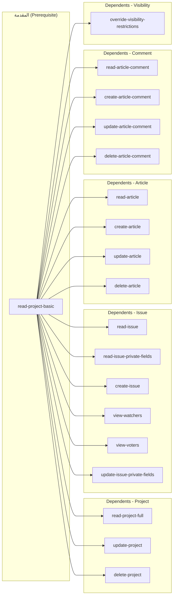
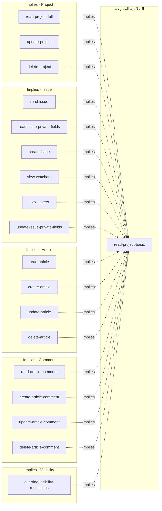
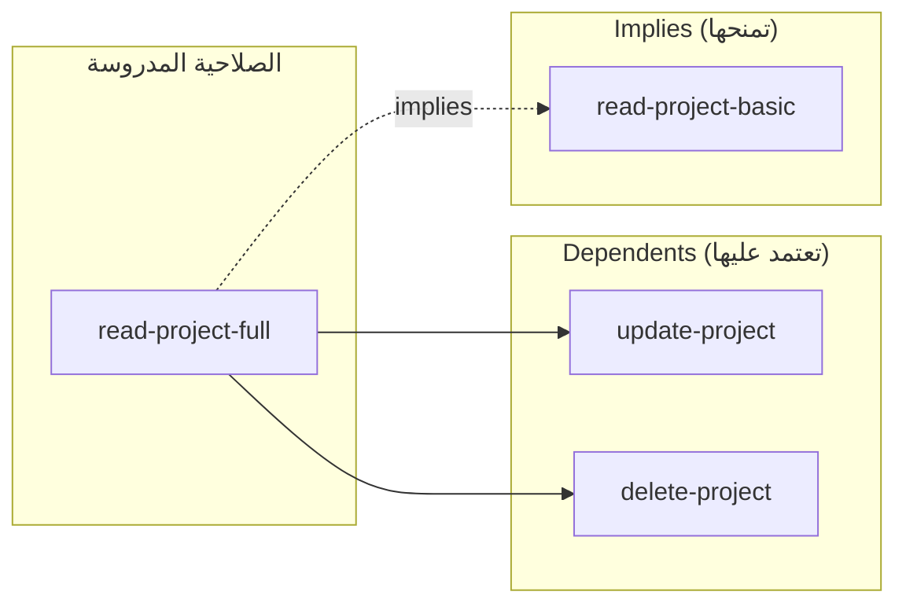
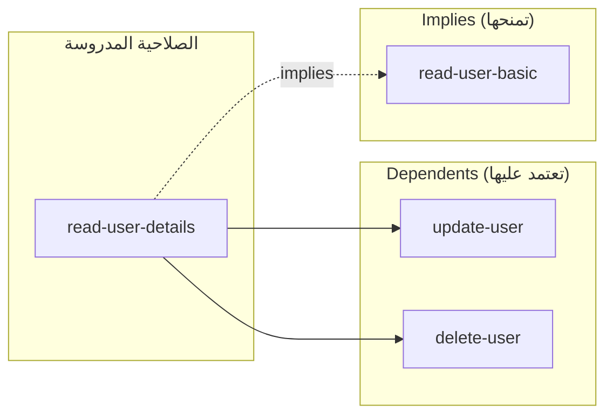
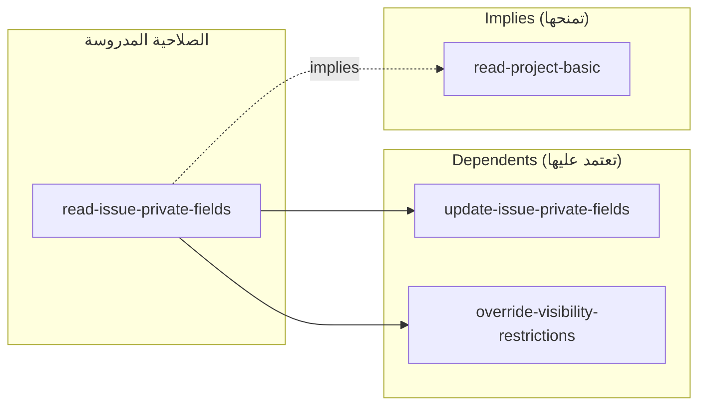
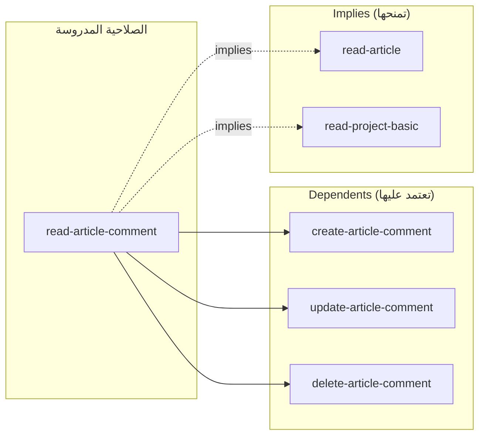
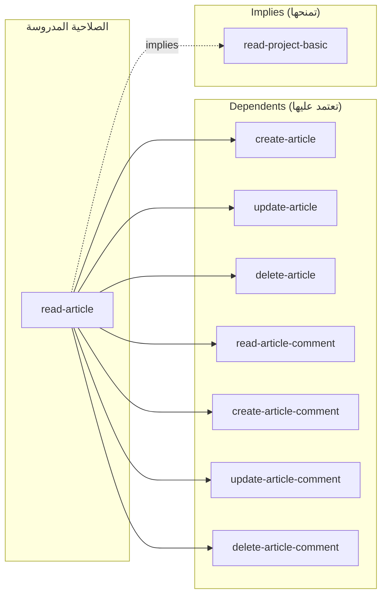

# مخطط علاقات الصلاحيات (Permission Relationships)

رسم بياني للعلاقات بين الصلاحيات الـ53، مشتقّ من قائمتَي
`dependents` و `implies` في `lib/core/enums/permission_enum.dart`
وجداول `permission_dependencies` في `migrations/000016_rbac_seed.up.sql`.

## الاتجاه (Legend)

> `A --> B`  تعني أن الصلاحية **B** تعتمد على الصلاحية **A**
> (أي A هي الشرط المسبق / prerequisite لـ B).

- العلاقة بين `dependents` و `implies` علاقة عكسية مزدوجة:
  إذا كان `X.implies` يحتوي `Y` فهذا مطابق لوجود `X` في `Y.dependents`.

## المخطط

```mermaid
flowchart LR
    %% ─────────────── Project ───────────────
    subgraph Project["Project"]
        read_project_basic["read-project-basic"]
        create_project["create-project"]
        read_project_full["read-project-full"]
        update_project["update-project"]
        delete_project["delete-project"]
    end

    %% ─────────────── Organization ───────────────
    subgraph Organization["Organization"]
        read_organization["read-organization"]
        update_organization["update-organization"]
        create_organization["create-organization"]
        delete_organization["delete-organization"]
    end

    %% ─────────────── User Profile ───────────────
    subgraph UserProfile["User Profile"]
        update_self["update-self"]
    end

    %% ─────────────── User ───────────────
    subgraph User["User"]
        read_user_basic["read-user-basic"]
        read_user_details["read-user-details"]
        update_user["update-user"]
        create_user["create-user"]
        delete_user["delete-user"]
    end

    %% ─────────────── System ───────────────
    subgraph System["System"]
        low_level_admin_read["low-level-admin-read"]
        low_level_admin_write["low-level-admin-write"]
    end

    %% ─────────────── Issue ───────────────
    subgraph Issue["Issue"]
        read_issue["read-issue"]
        read_issue_private_fields["read-issue-private-fields"]
        update_issue["update-issue"]
        create_issue["create-issue"]
        delete_issue["delete-issue"]
        link_issues["link-issues"]
        update_issue_private_fields["update-issue-private-fields"]
        apply_commands_silently["apply-commands-silently"]
        view_watchers["view-watchers"]
        update_watchers["update-watchers"]
        view_voters["view-voters"]
    end

    %% ─────────────── Attachment ───────────────
    subgraph Attachment["Attachment"]
        add_attachment["add-attachment"]
        update_attachment["update-attachment"]
        delete_attachment["delete-attachment"]
    end

    %% ─────────────── Comment ───────────────
    subgraph Comment["Comment"]
        create_issue_comment["create-issue-comment"]
        read_issue_comment["read-issue-comment"]
        update_issue_comment["update-issue-comment"]
        delete_issue_comment["delete-issue-comment"]
        update_not_own_issue_comment["update-not-own-issue-comment"]
        delete_not_own_comment["delete-not-own-comment-and-permanent-comment-delete"]
        read_article_comment["read-article-comment"]
        create_article_comment["create-article-comment"]
        update_article_comment["update-article-comment"]
        delete_article_comment["delete-article-comment"]
    end

    %% ─────────────── Visibility ───────────────
    subgraph Visibility["Visibility"]
        override_visibility["override-visibility-restrictions"]
    end

    %% ─────────────── Issue Work Item ───────────────
    subgraph WorkItem["Issue Work Item"]
        read_work_item["read-work-item"]
        update_work_item["update-work-item"]
        update_not_own_work_item["update-not-own-work-item"]
        create_work_item["create-work-item"]
        create_not_own_work_item["create-not-own-work-item"]
    end

    %% ─────────────── Article ───────────────
    subgraph Article["Article"]
        read_article["read-article"]
        create_article["create-article"]
        update_article["update-article"]
        delete_article["delete-article"]
    end

    %% ─────────────── App ───────────────
    subgraph App["App"]
        read_app_content["read-app-content"]
        update_app_content["update-app-content"]
    end

    %% ─────────────── Edges (prerequisite --> dependent) ───────────────
    read_project_basic --> read_project_full
    read_project_basic --> read_issue
    read_project_basic --> read_issue_private_fields
    read_project_basic --> create_issue
    read_project_basic --> view_watchers
    read_project_basic --> view_voters
    read_project_basic --> read_article
    read_project_basic --> create_article
    read_project_basic --> update_article
    read_project_basic --> delete_article
    read_project_basic --> read_article_comment
    read_project_basic --> create_article_comment
    read_project_basic --> update_article_comment
    read_project_basic --> delete_article_comment
    read_project_basic --> update_issue_private_fields
    read_project_basic --> override_visibility
    read_project_basic --> update_project
    read_project_basic --> delete_project

    read_project_full --> update_project
    read_project_full --> delete_project

    read_organization --> update_organization
    read_organization --> delete_organization

    update_self --> update_user

    read_user_basic --> read_user_details
    read_user_basic --> update_user
    read_user_basic --> delete_user

    read_user_details --> update_user
    read_user_details --> delete_user

    low_level_admin_read --> low_level_admin_write

    read_issue_private_fields --> update_issue_private_fields
    read_issue_private_fields --> override_visibility
    update_issue --> update_issue_private_fields

    read_issue_comment --> update_not_own_issue_comment
    read_issue_comment --> delete_not_own_comment

    read_article_comment --> create_article_comment
    read_article_comment --> update_article_comment
    read_article_comment --> delete_article_comment

    read_work_item --> update_not_own_work_item
    update_work_item --> update_not_own_work_item
    create_work_item --> create_not_own_work_item

    read_article --> create_article
    read_article --> update_article
    read_article --> delete_article
    read_article --> read_article_comment
    read_article --> create_article_comment
    read_article --> update_article_comment
    read_article --> delete_article_comment

    read_app_content --> update_app_content
```

## المخطط 2: `read-project-basic` من ناحية Dependents

من قائمة `dependents` الخاصة بـ `ProjectReadProjectBasic` في
`permission_enum.dart` (18 صلاحية تعتمد عليها).

> `read-project-basic --> X` تعني أن الصلاحية **X** تعتمد على `read-project-basic`
> (مطلوبة كمقدمة لها).

## المخطط 3: `read-project-basic` من ناحية Implies

`ProjectReadProjectBasic.implies` قائمة **فارغة** (لا تمنح أي صلاحية إضافية).

لكن العكس صحيح: توجد **18 صلاحية `implies` تقوم بمنح `read-project-basic`**
عند منحها (أي `X.implies` يحتوي `read-project-basic`).

> `X -.implies.-> read-project-basic` تعني أن منح الصلاحية **X** يمنح
> تلقائيًا صلاحية `read-project-basic`.

## المخطط 4: `read-project-full`

صلاحية **مشتركة** في الحالتين: لها `dependents` ولها `implies`.

> `read-project-full --> X` تعني أن X تعتمد عليها، وأن
> `read-project-full -.implies.-> Y` تعني أنها تمنح Y عند منحها.

## المخطط 5: `read-user-details`

صلاحية **مشتركة** في الحالتين: لها `dependents` ولها `implies`.

> `read-user-details --> X` تعني أن X تعتمد عليها، وأن
> `read-user-details -.implies.-> Y` تعني أنها تمنح Y عند منحها.

## المخطط 6: `read-issue-private-fields`

صلاحية **مشتركة** في الحالتين: لها `dependents` ولها `implies`.

> `read-issue-private-fields --> X` تعني أن X تعتمد عليها، وأن
> `read-issue-private-fields -.implies.-> Y` تعني أنها تمنح Y عند منحها.

## المخطط 7: `read-article-comment`

صلاحية **مشتركة** في الحالتين: لها `dependents` ولها `implies`.

> `read-article-comment --> X` تعني أن X تعتمد عليها، وأن
> `read-article-comment -.implies.-> Y` تعني أنها تمنح Y عند منحها.

## المخطط 8: `read-article`

صلاحية **مشتركة** في الحالتين: لها `dependents` ولها `implies`.

> `read-article --> X` تعني أن X تعتمد عليها، وأن
> `read-article -.implies.-> Y` تعني أنها تمنح Y عند منحها.

## ملاحظات

- الصلاحيات **المشتركة** بين `dependents` و `implies` (مخططات 4-8):
  `read-project-full`, `read-user-details`, `read-issue-private-fields`,
  `read-article-comment`, `read-article`.
- **`read-project-basic`** هي العقدة الجذرية الأكثر تشعبًا (18 صلة إخراج): معظم
  صلاحيات المشروع/القضية/المقالة تعتمد عليها.
- الصلاحيات **بدون أي صلة اعتماد** (أوراق/حرة): `create-project`,
  `create-organization`, `create-user`, `delete-issue`, `link-issues`,
  `apply-commands-silently`, `update-watchers`, `add-attachment`,
  `update-attachment`, `delete-attachment`, `create-issue-comment`,
  `update-issue-comment`, `delete-issue-comment`.
- `is_global = TRUE` للصلاحيات غير المرتبطة بمشروع (User/System/Org/App)،
  كما هو موثّق في `migrations/000016_rbac_seed.up.sql`.
