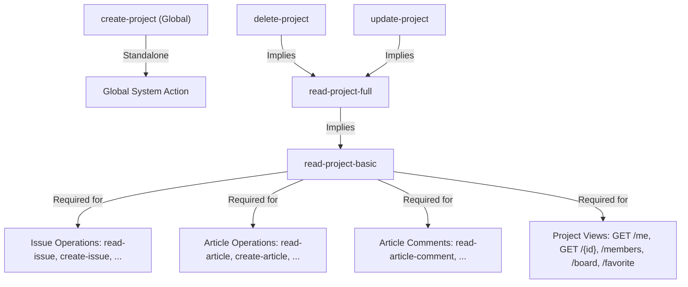

# تحليل شامل لصلاحيات المشاريع في نظام YouTrack Backend

يقدم هذا المستند تحليلاً تفصيلياً وهيكلياً لجميع الصلاحيات المتعلقة بالمشاريع (Project Permissions) المعرّفة في كود النظام ضمن الملف [`internal/services/permissions/permissions.go`](../../internal/services/permissions/permissions.go)، مع توضيح نطاق كل صلاحية (Scope)، ومتى يتم استخدامها، وكيفية ارتباطها بالصلاحيات الأخرى ونقاط النهاية (HTTP Endpoints).

---

## 1. نظرة عامة على نموذج الصلاحيات (Authorization Model Overview)

يعتمد نظام YouTrack Backend على نموذج **RBAC مع النطاقات (Scoped Role-Based Access Control)**. يتم تحديد الصلاحيات بناءً على:

1. **الكيان (Entity)**: الكيان المستهدف مثل `project`.
2. **العملية (Operation)**: نوع العملية المسموح بها مثل `read`, `create`, `update`, `delete`.
3. **النطاق (Scope)**:
   - **عام (Global Scope)**: يسري على مستوى النظام بالكامل (`scope_type = 'global'`).
   - **مخصص بالمشروع (Project Scope)**: يسري فقط على مشروع معين برقم معرّف محدد (`scope_type = 'project'`, `scope_id = <project_id>`).

---

## 2. جدول صلاحيات المشاريع (Project Permissions Catalog)

يحتوي النظام على **5 صلاحيات أساسية** خاصة بالمشاريع مباشرة ضمن `ProjectEntity`:

| معرّف الصلاحية (ID) | اسم الصلاحية (Name) | نوع النطاق (IsGlobal) | نوع العملية (Operation) | الوصف المختصر |
| :--- | :--- | :--- | :--- | :--- |
| `read-project-basic` | Read Project Basic | `false` (مشروع / عام) | `read` | عرض البيانات والإعدادات الأساسية للمشروع |
| `create-project` | Create Project | `true` (عام فقط) | `create` | إنشاء مشاريع جديدة في النظام |
| `read-project-full` | Read Project Full | `false` (مشروع / عام) | `read` | الوصول إلى التفاصيل الكاملة للمشروع وإعداداته المتقدمة |
| `update-project` | Update Project | `false` (مشروع / عام) | `update` | تعديل إعدادات وتفاصيل المشروع |
| `delete-project` | Delete Project | `false` (مشروع / عام) | `delete` | حذف المشروع نهائياً من النظام |

---

## 3. التحليل التفصيلي لكل صلاحية (Detailed Analysis)

### 3.1. صلاحية قراءة البيانات الأساسية للمشروع (`read-project-basic`)

- **المعرّف (ID)**: `read-project-basic`
- **الكيان (PermissionEntityType)**: `project`
- **الوحدة (LocalizedPermissionEntityType)**: `Project`
- **العملية (Operation)**: `read`
- **هل هي عامة فقط؟ (IsGlobal)**: `false` (يمكن منحها على مستوى مشروع محدد أو على مستوى عام).

#### متى تُستخدم وفي أي نطاق؟

- **النطاق (Scope)**:
  - **Project Scope**: تمنح المستخدم حق رؤية مشروع معين وتصفح البيانات الأساسية فيه.
  - **Global Scope**: تمنح المستخدم حق رؤية جميع المشاريع الأساسية في النظام.

- **استخداماتها الرئيسية**:
  - عرض قائمة المشاريع المتاحة للمستخدم (`GET /api/projects/me`).
  - رؤية ملخص مشروع معين (`GET /api/projects/{projectID}`).
  - رؤية أعضاء المشروع (`GET /api/projects/{projectID}/members`).
  - عرض لوحة المهام الخاصة بالمشروع (`GET /api/projects/{projectID}/board`).
  - إضافة المشروع إلى المفضلة (`PUT /api/projects/{projectID}/favorite`).
  - **حجر الأساس (Base Requirement)**: تُعتبر الصلاحية الأساسية المطلوبة للوصول إلى كافة الكيانات التابعة للمشروع (كالمهام `issues` والتقارير والمقالات `articles`).

#### العلاقات والتبعيّات (Dependencies & Implications)

- **تتضمن (Implies)**: لا تتضمن صلاحيات أخرى.

- **تعتمد عليها (Dependents)**: يعتمد عليها **18 صلاحية** في النظام، منها:
  - `read-project-full`, `update-project`, `delete-project`
  - `read-issue`, `create-issue`, `read-issue-private-fields`, `update-issue-private-fields`
  - `read-article`, `create-article`, `update-article`, `delete-article`
  - `read-article-comment`, `create-article-comment`, `update-article-comment`, `delete-article-comment`
  - `view-watchers`, `view-voters`, `override-visibility-restrictions`

---

### 3.2. صلاحية إنشاء مشروع جديد (`create-project`)

- **المعرّف (ID)**: `create-project`
- **الكيان (PermissionEntityType)**: `project`
- **الوحدة (LocalizedPermissionEntityType)**: `Project`
- **العملية (Operation)**: `create`
- **هل هي عامة فقط؟ (IsGlobal)**: `true` (**تُمنح فقط على المستوى العام Global Scope**).

#### 1 متى تُستخدم وفي أي نطاق؟

- **النطاق (Scope)**: **Global Scope حصراً**.

- **سبب النطاق العام**: عند إنشاء مشروع جديد، لا يكون للمشروع `project_id` قائم بعد لربط الصلاحية به، لذا يجب أن يمتلك المستخدم صلاحية إنشاء المشاريع على مستوى النظام ككل.
- **استخداماتها الرئيسية**:
  - استدعاء نقطة النهاية الخاصة بإنشاء مشروع جديد (`POST /api/projects/`).

---

### 3.3. صلاحية القراءة الكاملة للمشروع (`read-project-full`)

- **المعرّف (ID)**: `read-project-full`
- **الكيان (PermissionEntityType)**: `project`
- **الوحدة (LocalizedPermissionEntityType)**: `Project`
- **العملية (Operation)**: `read`
- **هل هي عامة فقط؟ (IsGlobal)**: `false`.

#### 2 متى تُستخدم وفي أي نطاق؟

- **النطاق (Scope)**: Project Scope (أو Global Scope).

- **استخداماتها الرئيسية**:
  - رؤية التفاصيل المتقدمة للمشروع (مثل الحقول المخصصة Advanced Custom Fields، إعدادات الربط بالمؤسسة Organization Settings، الصلاحيات المتقدمة للمشروع).
- **العلاقات (Implies & Dependents)**:
  - **تتضمن (Implies)**: تتضمن تلقائياً `read-project-basic`. (أي أن من يمتلك `read-project-full` يحصل تلقائياً على `read-project-basic`).
  - **تعتمد عليها (Dependents)**: `update-project`, `delete-project`.

---

### 3.4. صلاحية تحديث وتعديل المشروع (`update-project`)

- **المعرّف (ID)**: `update-project`
- **الكيان (PermissionEntityType)**: `project`
- **الوحدة (LocalizedPermissionEntityType)**: `Project`
- **العملية (Operation)**: `update`
- **هل هي عامة فقط؟ (IsGlobal)**: `false`.

#### 3 متى تُستخدم وفي أي نطاق؟

- **النطاق (Scope)**: Project Scope (أو Global Scope).

- **استخداماتها الرئيسية**:
  - تعديل إعدادات المشروع، تغيير الاسم، تغيير الوصف، ضبط ربط المؤسسات أو الحقول المخصصة.
- **العلاقات (Implies)**:
  - **تتضمن تلقائياً (Implies)**:
    - `read-project-full`
    - `read-project-basic`

---

### 3.5. صلاحية حذف المشروع (`delete-project`)

- **المعرّف (ID)**: `delete-project`
- **الكيان (PermissionEntityType)**: `project`
- **الوحدة (LocalizedPermissionEntityType)**: `Project`
- **العملية (Operation)**: `delete`
- **هل هي عامة فقط؟ (IsGlobal)**: `false`.

#### 4 متى تُستخدم وفي أي نطاق؟

- **النطاق (Scope)**: Project Scope (أو Global Scope).

- **استخداماتها الرئيسية**:
  - حذف المشروع نهائياً أو أرشفته وتصفية بياناته.
- **العلاقات (Implies)**:
  - **تتضمن تلقائياً (Implies)**:
    - `read-project-full`
    - `read-project-basic`

---

## 4. مخطط التسلسل الهرمي للضمان والتضمن (Permissions Hierarchy & Graph)

يوضح المخطط التالي علاقة التضمن الضمني (Implies) بين صلاحيات المشاريع والصلاحيات التابعة لها:

---

## 5. ربط الصلاحيات بنقاط النهاية للـ API والوسائط (API Endpoints & Middleware Mapping)

يتم حماية نقاط النهاية في [`internal/httphandlers/handles/projects/init.go`](../../internal/httphandlers/handles/projects/init.go) باستخدام وسيط التحقق من الصلاحيات:

| المسار (Endpoint) | الطريقة (Method) | الصلاحية المطلوبة (Required Permission) | الوسيط المستخدم (Middleware) | شرح النطاق |
| :--- | :--- | :--- | :--- | :--- |
| `/api/projects/me` | `GET` | `read-project-basic` | `middlewares.RequireGlobal` | يفحص الصلاحية على المستوى العام لعرض المشاريع المتاحة |
| `/api/projects/` | `POST` | `create-project` | `middlewares.RequireGlobal` | يفحص الصلاحية العامة لإنشاء مشروع جديد |
| `/api/projects/{projectID}` | `GET` | `read-project-basic` | `middlewares.RequireProject` | يفحص امتلاك الصلاحية للمشروع المحين `projectID` |
| `/api/projects/{projectID}/members` | `GET` | `read-project-basic` | `middlewares.RequireProject` | يفحص امتلاك الصلاحية للمشروع المحدد `projectID` |
| `/api/projects/{projectID}/issues` | `GET` | `read-issue` | `middlewares.RequireProject` | تتطلب `read-issue` (والتي تتضمن ضمنياً `read-project-basic`) |
| `/api/projects/{projectID}/board` | `GET` | `read-project-basic` | `middlewares.RequireProject` | يفحص امتلاك الصلاحية للمشروع المحدد `projectID` |
| `/api/projects/{projectID}/favorite` | `PUT` | `read-project-basic` | `middlewares.RequireProject` | يفحص امتلاك الصلاحية للمشروع المحدد `projectID` |

---

## 6. كيفية تحقق محرك الصلاحيات في الكود (Authorization Resolution Mechanism)

عند طلب أي عملية على مشروع:

1. **التحقق من النطاق في الوسيط (`RequireProject` / `RequireGlobal`)**:
   - يقوم الوسيط بتدوين نوع النطاق واستخراج `projectID` من مسار API.
   - يتأكد الوسيط من توافق الصلاحية مع النطاق من خلال دالة `ScopeAllows(p Permission, s ScopeType)`.

2. **التحقق الضمني المتبادل (`matchPermission` & `GrantingPermissions`)**:
   - عند البحث عن إتاحة صلاحية مثل `read-project-basic` للمستخدم، تُنفذ دالة `GrantingPermissions(PermProjectReadProjectBasic)`.
   - تُرجع الدالة جميع الصلاحيات العليا التي تمنح `read-project-basic` ضمنياً (مثل `read-project-full`, `update-project`, `delete-project`).
   - إذا كان للمستخدم دور يحتوي على أي من هذه الصلاحيات المانحة في قاعدة البيانات لجدول `assigned_roles` بنفس `project_id` أو بـ `scope_type = 'global'`, يتم منح المستخدم الوصول بنجاح.

3. **الاستعلام في قاعدة البيانات (SQL Queries)**:
   - تستخدم الدوارل مثل `GetVisibleToUser` و `IsVisibleToUser` قائمة المراجع المانحة `grantingPermissionRefs(perms.PermProjectReadProjectBasic)` لتصفية المشاريع واسترجاع المشاريع التي يملك المستخدم صلاحية قراءتها فقط.

---

## 7. الخلاصة والملخص التنفيذي

- **الصلاحية المركزية**: تُعد `read-project-basic` هي الصلاحية الأهم والأكثر محورية في نموذج المشاريع، حيث تعتمد عليها 18 صلاحية فرعية وجميع عمليات قراءة الكيانات داخل المشروع.
- **إنشاء المشاريع**: الصلاحية الوحيدة العامة تماماً هي `create-project` لأن عملية الإنشاء تتم قبل وجود مشروع مستهدف.
- **التعديل والحذف**: الصلاحيات `update-project` و `delete-project` تتضمن تلقائياً القراءة الكاملة والأساسية للمشروع لضمان أداء التغييرات بسلاسة دون الحاجة لإسناد أدوار متعددة للمستخدم.
