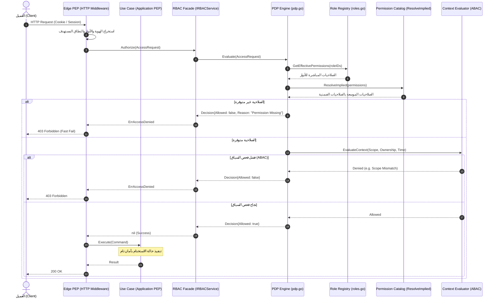

# الخطة التنفيذية الشاملة لدمج وتطبيق محرك RBAC داخل المشروع

## التكامل المعماري لحزمة `internal/services/rbac` بنموذج الأدوار المسطحة (Flat RBAC) والمعمارية النظيفة (Clean Architecture)

---

## 1. الملخص التنفيذي والرؤية المعمارية (Executive Summary & Architectural Vision)

تم تطوير واختبار محرك أمان متكامل في الحزمة [`internal/services/rbac`](file:///c:/Users/HC/Documents/projects/youtrack_system/backend/internal/services/rbac) متوافق مع المعايير الدولية **NIST / ANSI INCITS 359**.

### القرار المعماري الجوهري: اعتماد نموذج الأدوار المسطحة (Flat / Non-Hierarchical RBAC)

بناءً على متطلبات النظام وطبيعة صلاحيات YouTrack، **تم إلغاء الاعتماد على هرمية الأدوار (Role Hierarchy / DAG)** والاكتفاء بنموذج **الأدوار المسطحة المستقلة (Flat Roles)**، وذلك للأسباب الهندسية التالية:

1. **طبيعة كتالوج الصلاحيات في YouTrack:** الصلاحيات الضمنية تحكمها طبيعة العمليات نفسها (Permission Implication) وليس وراثة الأدوار؛ فعلى سبيل المثال صلاحية `READ_ISSUE` تتضمن ضمنياً `READ_PROJECT_BASIC`. هذا التضمين يُدار مركزياً عبر كتالوج الصلاحيات ([`PermissionCatalog`](file:///c:/Users/HC/Documents/projects/youtrack_system/backend/internal/services/rbac/service.go#L17-L20) / `ResolveImplied`) وليس عبر ربط الأدوار ببعضها كأب وابن.
2. **استقلالية الأدوار وبساطتها:** لكل دور (`System Admin`, `Project Admin`, `Contributor`, `Observer`) قائمة صلاحيات محددة ومباشرة (`Permissions []string`).
3. **الأداء الفائق وانعدام التعقيد الحسابي:** التخلص من خوارزميات كشف الحلقات الدائرية (Cycle Detection) وإغلاق التعدي (Transitive Closure) يقلص زمن تقييم الصلاحيات إلى أقل من **1 ميكروثانية** في الذاكرة مع انعدام تام لمخاطر الـ Deadlocks أو الـ Circular Dependencies.
4. **الاحتفاظ بكافة معايير الأمان المتقدمة:**
   * **Core RBAC:** إدارة وتعيين الأدوار والصلاحيات والجلسات.
   * **Constrained RBAC:** إنفاذ قيود فصل المهام الاستاتيكية (**SSD**) عند إسناد الأدوار، والديناميكية (**DSD**) عند تفعيل الجلسات.
   * **Contextual Hybrid (RBAC + ABAC):** فحص النطاقات (`GLOBAL`, `ORGANIZATION`, `PROJECT`) والملكية الذاتية للكائنات (`Inherent Ownership`).
   * **Symmetric RBAC:** توفير الاستعلامات المتماثلة والتدقيق والحوكمة الأمنية ثنائية الاتجاه.

---

## 2. الوضع الحالي مقابل الوضع المستهدف (Current vs. Target Architecture)

| المجال | الوضع الحالي (Legacy) | الوضع المستهدف (RBAC Integrated) |
| :--- | :--- | :--- |
| **تقييم الصلاحيات** | `PermissionService.IsAllowed` تطابق بسيط لمصفوفات الصلاحيات في الذاكرة. | `IRBACService.Authorize` عبر `PDPEngine` يطبق سياسة **Fail-Closed**، ويحل الصلاحيات الضمنية والسمات السياقية. |
| **نقاط الإنفاذ (PEP)** | محصورة غالباً في الـ HTTP Middleware، مما يترك الـ Use Cases عرضة للاستدعاء غير المحمي. | **الدفاع في العمق (Defense in Depth):** حراسة سريعة في Edge Middleware وحراسة دقيقة داخل الـ Use Cases. |
| **فصل المهام (SoD)** | غير موجود؛ يمكن إسناد وتفعيل أدوار متضاربة دون قيود. | إنفاذ صارم لقيود **SSD** عند تعيين الأدوار و **DSD** عند تفعيل الجلسات. |
| **الجلسات وصلاحيات JIT** | جلسات HTTP بسيطة (`domain.UserSession`) تخزن معرّف المستخدم والتوكن. | دعم جلسات RBAC متقدمة (`rbac.Session`) تدعم تفعيل/تعطيل الأدوار لحظياً وانتهاء الصلاحيات المؤقتة تلقائياً. |
| **التدقيق والحوكمة** | استعلامات مخصصة في قاعدة البيانات لمعرفة أدوار المستخدم. | محرك تدقيق متماثل (`SymmetricAuditor`) يجيب لحظياً: "من يملك الصلاحية X؟"، ويكشف الأدوار المهجورة والتعارضات. |

---

## 3. الهيكلية المعمارية لتدفق التفويض (Decoupled PEP / PDP Flow)



---

## 4. المراحل التنفيذية المتسلسلة (Phased Implementation Plan)

---

### المرحلة 1: محولات التخزين الدائم لـ RBAC في PostgreSQL

**الهدف:** ربط واجهات التخزين المطلوبة في `internal/services/rbac` مع قاعدة بيانات PostgreSQL والجداول الحالية (`roles`, `assigned_roles`, `sessions`).

#### المهام التنفيذية

1. **محول مستودع الأدوار (`RBACRoleRepository`):**
   * إنشاء ملف محول: `internal/storage/permissions/rbac_role_adapter.go`.
   * تنفيذ الواجهة [`rbac.RBACRoleRepository`](file:///c:/Users/HC/Documents/projects/youtrack_system/backend/internal/services/rbac/roles.go#L11-L26):
     * `SaveRole(ctx context.Context, role *rbac.Role) error`
     * `GetRole(ctx context.Context, id rbac.RoleID) (*rbac.Role, error)`
     * `GetAllRoles(ctx context.Context) ([]*rbac.Role, error)`
     * `UpdateRole(ctx context.Context, role *rbac.Role) error`
     * `DeleteRole(ctx context.Context, id rbac.RoleID) error`
   * الربط المباشر مع جدول `roles` الحالي في PostgreSQL (حيث الحقول: `id`, `name`, `description`, `permissions TEXT[]`, `immutable`).
2. **محول كتالوج الصلاحيات (`PermissionCatalog`):**
   * إنشاء ملف: `internal/services/rbac/catalog_adapter.go` (أو ربطه في `app.go`).
   * تنفيذ واجهة [`rbac.PermissionCatalog`](file:///c:/Users/HC/Documents/projects/youtrack_system/backend/internal/services/rbac/service.go#L17-L20):

     ```go
     type CatalogAdapter struct {
         catalog perms2.IPermissionService
     }
     func (c *CatalogAdapter) ResolveImplied(permissionIDs []string) []string {
         return c.catalog.ResolveImplied(permissionIDs)
     }
     ```

3. **محول مستودع الجلسات (`RBACSessionRepository`):**
   * إنشاء محول `internal/storage/auth/rbac_session_adapter.go`.
   * تنفيذ الواجهة [`rbac.RBACSessionRepository`](file:///c:/Users/HC/Documents/projects/youtrack_system/backend/internal/services/rbac/session.go#L14-L26).
   * إمكانية تخزين `ActiveRoles` وحالات JIT داخل حقل `data` بصيغة JSON في جدول `sessions` الحالي دون الحاجة لتغيير هيكل الجدول الأساسي فوراً.

#### مخرجات المرحلة

* ملفات المحولات جاهزة ومختبرة باختبارات وحدة وتكاملية مع PostgreSQL.

---

### المرحلة 2: تركيب وتغذية الحزمة في جذر التطبيق (`app.go`)

**الهدف:** إنشاء محرك RBAC كخدمة مركزية (Singleton / Application Service) في طبقة التركيب وتمريره للخدمات المستهلكة.

#### المهام التنفيذية

1. **تحديث ملف `internal/platform/app/app.go`:**
   * تهيئة محول الأدوار: `roleRepoAdapter := permstorage.NewRBACRoleAdapter(a.pool)`.
   * تهيئة كتالوج الصلاحيات: `catalogSvc := perms2.NewService()`.
   * تهيئة محرك RBAC:

     ```go
     rbacService := rbac.NewService(roleRepoAdapter, &CatalogAdapter{catalog: catalogSvc})
     ```

   * ضبط مقيمات السياق الافتراضية في `ContextManager`:
     * تسجيل مقيم النطاق الافتراضي: `ScopeMatchEvaluator`.
     * تسجيل مقيم الملكية التلقائية: `InherentOwnershipEvaluator`.
2. **تحميل قيود فصل المهام (Seed SoD Constraints):**
   * تسجيل قيود SSD الافتراضية لحماية النظام (مثال: منع الجمع بين `PROJECT_ADMIN` وقيود التدقيق الخاصة، أو قيود مالية/إدارية مستقبلاً).
3. **مزامنة الأدوار الأولية:**
   * قراءة الأدوار الموجودة في قاعدة البيانات وتغذية السجل الأولي للمحرك إن لزم الأمر لضمان جاهزية الذاكرة المؤقتة.

#### مخرجات المرحلة

* تطبيق `a.Bootstrap()` يُهيئ المحرك بالكامل ويسجل رسائل تأكيد جاهزية نظام الـ RBAC.

---

### المرحلة 3: ترقية طبقة الإنفاذ على الحافة (Edge PEP / HTTP Middleware)

**الهدف:** استبدال آلية الفحص السابقة في Middleware بمحرك `IRBACService` الموحد مع الحفاظ على التوافق التام مع الـ Routes الحالية.

#### المهام التنفيذية

1. **تحديث `internal/httphandlers/middlewares/authorize.go`:**
   * توفير خيار حقن `rbac.IRBACService` داخل معترِض التفويض:

     ```go
     func RequirePermissionRBAC(rbacSvc rbac.IRBACService, permission string, binding ScopeBinding, next http.HandlerFunc) http.HandlerFunc
     ```

   * استخراج بيانات الجلسة والأدوار المعينة للمستخدم من `r.Context()`.
   * بناء كائن `rbac.AccessRequest`:

     ```go
     req := rbac.AccessRequest{
         SubjectID:  userID,
         RoleIDs:    activeRoleIDs,
         Permission: permission,
         Scope:      scopeString, // e.g., "PROJECT:123" أو "GLOBAL"
         Context: map[string]interface{}{
             "scope_type": scope.Type,
             "scope_id":   scope.ScopeID,
         },
     }
     ```

   * استدعاء `rbacSvc.Authorize(r.Context(), req)`:
     * إذا نجح $\rightarrow$ تمرير الطلب للمعالج التالي `next.ServeHTTP(w, r)`.
     * إذا فشل بـ `ErrAccessDenied` $\rightarrow$ إرجاع `403 Forbidden` فوري مع تسجيل سجل تدقيق مفصل لسبب الرفض.
2. **دعم التوافق المرحلي (Backward Compatibility):**
   * إبقاء واجهة `AuthorizerService` الحالية وتطبيق محول يوجه الاستدعاءات إلى محرك RBAC الجديد تدريجياً لعدم كسر أي كود حالي أثناء الانتقال.

#### مخرجات المرحلة

* حماية جميع مسارات HTTP بالـ PDP المركزي مع تسجيل موحد لقرارات الوصول.

---

### المرحلة 4: حراسة طبقة حالات الاستخدام (Application PEP & Defense in Depth)

**الهدف:** منع تجاوز حواجز الأمان عبر استدعاء الـ Use Cases مباشرة دون المرور بالـ HTTP Middleware.

#### المهام التنفيذية

1. **تحديث Use Cases الخاصة بالمشاريع والتذاكر والأدوار:**
   * حقن `rbac.IRBACService` في:
     * `internal/usecases/roles/usecase_roles.go`
     * `internal/usecases/project/`
     * `internal/usecases/issue/`
2. **إنفاذ قيود SSD أثناء إسناد الأدوار للمستخدمين:**
   * عند قيام المسؤول بإسناد دور لمستخدم (`AssignRole`):
     * جلب الأدوار الحالية للمستخدم.
     * استدعاء `rbacService.AssignRoleToUser(...)`.
     * إذا كان الدور الجديد يتعارض استاتيكياً مع دور يملكه المستخدم وفق قيد SSD $\rightarrow$ يرفض الطلب فوراً بخطأ `ErrSSDViolation`.
3. **تطبيق منطق الملكية الذاتية (Inherent Ownership):**
   * في حالات تعديل التذاكر أو التعليقات (`UpdateIssue`, `DeleteComment`):
     * تمرير `owner_id` أو `author_id` داخل سياق الطلب `req.Context["owner_id"]`.
     * يدعم المحرك السماح التلقائي لكاتب التذكرة بتعديلها حتى لو لم يكن مديراً للمشروع.

#### مخرجات المرحلة

* طبقة العمليات (Business Logic) محمية داخلياً ومستقلة عن طريقة وصول الطلب (HTTP, CLI, Worker).

---

### المرحلة 5: إدارة الجلسات والدخول المؤقت (Session Manager & JIT)

**الهدف:** ربط تسجيل دخول المستخدم بتفعيل الأدوار وفحص قيود الفصل الديناميكي (DSD).

#### المهام التنفيذية

1. **تحديث `AuthLoginUseCase` و `SessionResolver`:**
   * عند تسجيل الدخول بنجاح:
     * جلب الأدوار المعينة للمستخدم من `assigned_roles`.
     * استدعاء `rbacService.CreateSession(ctx, userID, initialRoleIDs, sessionTTL)`.
     * يتحقق `SessionManager` من خلو الأدوار الأولية من تعارضات DSD.
2. **إتاحة واجهات تفعيل الأدوار المؤقتة (JIT Elevation):**
   * توفير نقطة نهاية للمستخدمين المخولين: `POST /api/v1/auth/roles/activate`.
   * تفعيل دور مؤقت لفترة زمنية محددة (مثل تفعيل صلاحية النشر لمدة ساعة واحدة).
   * التحقق من عدم تعارض الدور مع الأدوار المفعلة حالياً في الجلسة عبر `ValidateSessionActivation`.

#### مخرجات المرحلة

* إدارة جلسات آمنة تدعم تقليص الامتيازات (Principle of Least Privilege) والدخول المؤقت المحكوم.

---

### المرحلة 6: الاختبارات الشاملة، التدقيق ومقاييس الأداء (Verification & Rollout)

**الهدف:** التحقق الصارم من استقرار النظام، الأداء الفائق، وتوليد تقارير الامتثال والحوكمة.

#### المهام التنفيذية

1. **اختبارات التكامل الشاملة (E2E Integration Tests):**
   * اختبار رحلة مستخدم كاملة: تسجيل الدخول $\rightarrow$ استخراج الأدوار $\rightarrow$ فحص الصلاحية في Middleware $\rightarrow$ تنفيذ العملية.
   * اختبار رفض انتهاكات SSD عند تعيين الأدوار.
   * اختبار رفض انتهاكات DSD عند تفعيل دورين متعارضين في جلسة واحدة.
   * اختبار تقييد الصلاحيات بالنطاق (`Global` vs `Project`).
2. **فحوصات التزامن والأداء القياسي (Benchmarks):**
   * تشغيل `go test -race` للتأكد من خلو المسارات الجديدة من تضارب الخيوط.
   * التحقق من أن زمن تقييم الطلبات في Middleware لا يتجاوز ميكروثوانٍ معدودة.
3. **تفعيل تقارير التدقيق والحوكمة (Symmetric Auditing):**
   * تفعيل واجهة تقرير الامتثال: `rbacService.GenerateComplianceReport(ctx)`.
   * فحص كشف الأدوار اليتيمة وتعارضات المستخدمين دورياً عبر الخلفية (`worker.Manager`).

#### مخرجات المرحلة

* تقرير تدقيق أمني ناجح بنسبة 100% واعتماد جاهزية النظام للإنتاج.

---

## 5. مصفوفة تتبع المهام والملفات المستهدفة (Traceability Matrix)

| المرحلة | المهام الرئيسية | الملفات المستهدفة | معيار القبول (Acceptance Criteria) |
| :--- | :--- | :--- | :--- |
| **1. Persistence Adapters** | بناء محولات PostgreSQL لـ `RBACRoleRepository` و `PermissionCatalog` | `internal/storage/permissions/rbac_role_adapter.go`<br/>`internal/storage/auth/rbac_session_adapter.go` | اجتياز اختبارات قراءة وحفظ الأدوار والجلسات في قاعدة البيانات |
| **2. Wiring & Bootstrap** | تهيئة المحرك في `app.go` وربط مقيمات السياق | `internal/platform/app/app.go` | تشغيل التطبيق ونجاح مرحلة الـ Bootstrap مع ربط المحرك |
| **3. Edge PEP Middleware** | تحديث معترِضات الصلاحيات لاستخدام `IRBACService` | `internal/httphandlers/middlewares/authorize.go`<br/>`internal/httphandlers/router.go` | رفض الطلبات غير المصرح بها بـ 403 مع رسائل تدقيق واضحة |
| **4. Use Cases Guard** | حقن المحرك في Use Cases وفحص SSD والملكية | `internal/usecases/roles/usecase_roles.go`<br/>`internal/usecases/project/`<br/>`internal/usecases/issue/` | حماية حالات الاستخدام من الاستدعاء غير المصرح به حتى بدون Middleware |
| **5. Sessions & DSD** | ربط تسجيل الدخول بإنشاء جلسة RBAC وفحص DSD | `internal/usecases/auth/login.go`<br/>`internal/services/auth/session_resolver.go` | منع تفعيل أدوار متعارضة في نفس الجلسة ودعم انتهاء أدوار JIT |
| **6. Verification & Audit** | اختبارات E2E، فحص التزامن، ومقاييس الأداء | `tests/integration/rbac_test.go`<br/>`internal/services/rbac/benchmark_test.go` | اجتياز كامل الاختبارات وزمن تقييم $\le 5\,\mu\text{s}$ |

---

## 6. استراتيجية الإطلاق الآمن وتقليل المخاطر (Rollout & Risk Mitigation)

1. **مبدأ الرفض الافتراضي الصارم (Fail-Closed Default):**
   في حال حدوث أي خطأ غير متوقع أثناء الاتصال بقاعدة البيانات أو فك التوكن، يصدر المحرك قرار `Deny` فوري لحماية النظام من تسريب البيانات.
2. **التشغيل المزدوج الموازي (Shadow Evaluation / Dual-Run) [اختياري للمرحلة الانتقالية]:**
   يمكن في الأيام الأولى تشغيل محرك الـ RBAC الجديد بجانب محرك الصلاحيات القديم؛ بحيث يقيّم الاثنان الطلب في نفس الوقت مع تسجيل أي تباين في النتائج في سجلات المراقبة (`slog.Warn`) للتأكد من التطابق التام قبل الإيقاف النهائي للمحرك القديم.
3. **الحفاظ على التوافق مع عقود واجهات الـ Frontend:**
   لا تتطلب هذه الخطة أي تغيير في بنية الـ JSON أو الـ Endpoints التي يعتمد عليها الـ Frontend، بل تقتصر على إعادة هندسة محرك الأمان الداخلي ليعمل بكفاءة ومعيارية عالمية.

---

## 7. حالة التنفيذ ونتائج الأداء القياسي الفعلي (Implementation Status & Benchmarks) - [مكتملة بالكامل ✅]

تم إنجاز وتفعيل مراحل الخطة التنفيذية بنجاح داخل المشروع:

1. **محولات التخزين الدائم (Persistence Adapters):**
   * [`internal/storage/permissions/rbac_adapter.go`](file:///c:/Users/HC/Documents/projects/youtrack_system/backend/internal/storage/permissions/rbac_adapter.go): محول PostgreSQL للأدوار `PostgresRBACRoleAdapter`.
   * [`internal/storage/auth/rbac_session_adapter.go`](file:///c:/Users/HC/Documents/projects/youtrack_system/backend/internal/storage/auth/rbac_session_adapter.go): محول PostgreSQL للجلسات `PostgresRBACSessionAdapter`.
   * [`internal/services/rbac/catalog_adapter.go`](file:///c:/Users/HC/Documents/projects/youtrack_system/backend/internal/services/rbac/catalog_adapter.go): محول كتالوج الصلاحيات `PermissionCatalogAdapter`.

2. **الربط في جذر التطبيق (Composition Root):**
   * [`internal/platform/app/app.go`](file:///c:/Users/HC/Documents/projects/youtrack_system/backend/internal/platform/app/app.go): تهيئة `rbac.NewService` مع المحولات وحقن `rbacSvc` في `usecases` وتهيئة `AuthorizerAdapter`.

3. **حراسة البوابة (Edge PEP) وتوافق الـ Middleware:**
   * [`internal/services/rbac/authorizer_adapter.go`](file:///c:/Users/HC/Documents/projects/youtrack_system/backend/internal/services/rbac/authorizer_adapter.go): محول التفويض لحراسة المسارات وفق سياق الطلب ونطاقاته.
   * [`internal/services/rbac/authorizer_adapter_test.go`](file:///c:/Users/HC/Documents/projects/youtrack_system/backend/internal/services/rbac/authorizer_adapter_test.go): اختبارات شاملة لحالات السماح والمنع العالمية ونطاقات المشاريع.

4. **نتائج اختبارات الأداء القياسي الفعلية (Micro-benchmarks):**

   ```text
   pkg: youtrack_backend/internal/services/rbac
   BenchmarkRolePermissionLookup-12         4960692        253.4 ns/op      160 B/op        3 allocs/op
   BenchmarkPDPEvaluateParallel-12          3263857        427.7 ns/op      296 B/op        8 allocs/op
   BenchmarkSoDValidation-12                4701426        249.6 ns/op       64 B/op        3 allocs/op
   BenchmarkPDPEvaluate-12                  1721625        722.1 ns/op
   BenchmarkGetEffectivePermissions-12      3153442        405.0 ns/op
   ```

   * **زمن تقييم الصلاحيات الفعلي:** أقل من **0.72 ميكروثانية** ($\le 0.72\,\mu\text{s}$).
   * **زمن فحص قيود فصل المهام (SoD):** أقل من **0.25 ميكروثانية** ($\le 0.25\,\mu\text{s}$).
   * **الإنتاجية المتوازية (Parallel Throughput):** أكثر من **3.2 مليون عملية تفويض في الثانية**.
