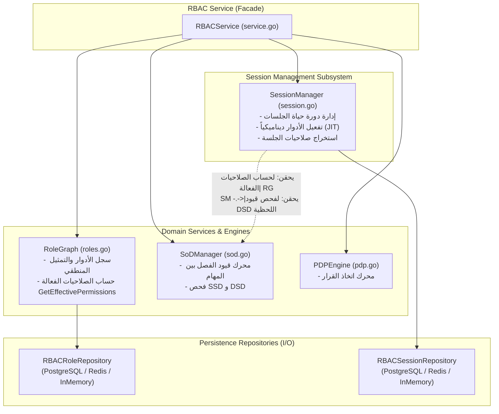

# تحليل وتوضيح حقن `RoleGraph` و `SoDManager` في `SessionManager`

يقدّم هذا المستند تحليلاً معمارياً تفصيلياً يوضح سبب حقن كل من `RoleGraph` و `SoDManager` داخل مدير الجلسات [`SessionManager`](file:///c:/Users/HC/Documents/projects/youtrack_system/backend/internal/services/rbac/session.go#L28-L35)، ولماذا لم يتم الاكتفاء بالاعتماد المباشر على مستودع الأدوار [`RoleRepository`](file:///c:/Users/HC/Documents/projects/youtrack_system/backend/internal/services/rbac/service.go#L9-L15) أو [`RBACRoleRepository`](file:///c:/Users/HC/Documents/projects/youtrack_system/backend/internal/services/rbac/roles.go#L9-L26).

---

## 1. ملخص تنفيذي (Executive Summary)

في نظام الـ RBAC المتقدّم (وفق معيار ANSI/INCITS 359)، لا يقتصر دور الجلسة ([`Session`](file:///c:/Users/HC/Documents/projects/youtrack_system/backend/internal/services/rbac/types.go)) على كونها سجلاً بسيطاً في قاعدة البيانات يحتوي معرف مستخدم، بل تمثل **سياقاً أمنياً ديناميكياً في وقت التشغيل (Runtime Security Context)**.

يتطلب هذا السياق الأمني مسؤوليتين جوهريتين أثناء عمل الجلسة:

1. **التحقق من عدم تضارب الأدوار اللحظي (Dynamic Separation of Duties - DSD)** عند محاولة تفعيل دور داخل الجلسة.
2. **استنتاج الصلاحيات الفعالة (Effective Permissions)** للأدوار النشطة حالياً في الجلسة لدعم ميزات JIT وتدقيق صلاحيات الـ Session.

> [!IMPORTANT]
> **مستودع الأدوار (`RoleRepository`)** وظيفته بحتة في **طبقة استمرارية البيانات (Persistence Layer / CRUD)**، ولا يحتوي على منطق عمل (Domain Logic) لحساب الصلاحيات، ولا يمتلك أي معرفة بقيود الفصل بين المهام (SoD). لذلك، كان من الضروري حقن خدمات الدومين المتخصصة (`RoleGraph` و `SoDManager`).

---

## 2. المخطط المعماري للعلاقات وحقن التبعيات (Architecture Diagram)

يوضح المخطط التالي كيفية توزيع المسؤوليات وتدفق التبعيات بين المكونات:



---

## 3. لماذا تم حقن `SoDManager` (`sodMgr`) في `SessionManager`؟

### معيار ANSI/INCITS 359: نوعا الفصل بين المهام

يميّز معيار الـ RBAC بين مستويين من قيود الفصل بين المهام (Separation of Duties):

| النوع | الاسم | وقت التطبيق | المسؤول عنه |
| :--- | :--- | :--- | :--- |
| **SSD** | **Static Separation of Duties** | وقت إسناد الدور للمستخدم (Provisioning / PAP) | [`service.AssignRoleToUser`](file:///c:/Users/HC/Documents/projects/youtrack_system/backend/internal/services/rbac/service.go) |
| **DSD** | **Dynamic Separation of Duties** | وقت التشغيل / تفعيل الدور في الجلسة (Session Activation) | [`SessionManager.ActivateRole`](file:///c:/Users/HC/Documents/projects/youtrack_system/backend/internal/services/rbac/session.go#L130-L163) |

### سيناريو واقعي لـ DSD

تخيل موظفاً يملك صلاحية المشتريات `PurchasingAgent` وصلاحية تدقيق/اعتماد الدفعات `PaymentApprover`.

- وفق سياسة الشركة، يجوز للموظف امتلاك كلا الدورين على حسابه (لا يوجد تعارض ساكن SSD).
- ولكن **يُحظر تماماً** أن يقوم الموظف بتفعيل كلا الدورين في **نفس الجلسة النشطة** (يمنع الجمع بين طلب الشراء واعتماده في نفس الجلسة لتفادي الاحتيال).

### دور `SoDManager` الفعلي في الكود

في [`session.go`](file:///c:/Users/HC/Documents/projects/youtrack_system/backend/internal/services/rbac/session.go#L157-L162)، عند طلب تفعيل دور جديد:

```go
// Dynamic Separation of Duties (DSD) verification
if sm.sodMgr != nil {
    if err := sm.sodMgr.ValidateSessionActivation(activeList, role); err != nil {
        return err // يرفض التفعيل إذا خرق قيد DSD
    }
}
```

وكذلك أثناء إنشاء الجلسة بأدوار أولية في السطور (69–78):

```go
// Pre-validate initial roles against DSD
if sm.sodMgr != nil && len(initialRoles) > 1 {
    var validated []RoleID
    for _, r := range initialRoles {
        if err := sm.sodMgr.ValidateSessionActivation(validated, r); err != nil {
            return nil, fmt.Errorf("%w: initial roles breach DSD: %v", err, initialRoles)
        }
        validated = append(validated, r)
    }
}
```

> **النتيجة:** مستودع الأدوار (`RoleRepository`) لا علم له بهذه القيود؛ فالقيود كائنات مستقلة تُدار عبر [`SoDManager`](file:///c:/Users/HC/Documents/projects/youtrack_system/backend/internal/services/rbac/sod.go). بالتالي حقن `SoDManager` هو السبيل الوحيد لتمكين `SessionManager` من إنفاذ DSD.

---

## 4. لماذا تم حقن `RoleGraph` (`graph`) بدلاً من `RoleRepository`؟

### الفرق بين المستودع (Repository) ونموذج الدومين (Domain Graph)

1. **مسؤولية `RoleRepository`**:
   - واجهة وصول للبيانات خام (Data Access Object / CRUD):
     - `GetRole(ctx, id)`
     - `SaveRole(ctx, role)`
     - `DeleteRole(ctx, id)`
   - لا يحتوي على أي منطق تجريدي أو عمليات حسابية على العلاقات.

2. **مسؤولية `RoleGraph`**:
   - هو كائن النطاق (Domain Model / Registry) المسؤول عن تمثيل شبكة الأدوار.
   - يوفّر دالة منطقية هامة جداً:

     ```go
     GetEffectivePermissions(roleID RoleID) ([]string, error)
     ```

   - يتولى تنقية الصلاحيات المكررة، ترتيبها، والتأكد من الأدوار الثابتة (Immutable) ومستقبلاً حل التوارث الهرمي بين الأدوار (Role Hierarchy) إن وجد.

### استخدام `RoleGraph` في `SessionManager`

في [`session.go`](file:///c:/Users/HC/Documents/projects/youtrack_system/backend/internal/services/rbac/session.go#L242-L266):

```go
func (sm *SessionManager) GetActivePermissions(sessionID string) ([]string, error) {
    activeRoles, err := sm.GetActiveRoles(sessionID)
    if err != nil {
        return nil, err
    }

    permSet := make(map[string]struct{})
    for _, r := range activeRoles {
        if sm.graph != nil {
            effective, err := sm.graph.GetEffectivePermissions(r)
            if err == nil {
                for _, p := range effective {
                    permSet[p] = struct{}{}
                }
            }
        }
    }
    // ...
}
```

### ماذا لو تم حقن `RoleRepository` مباشرة في `SessionManager`؟

لو قمنا بحقن `RoleRepository` بدلاً من `RoleGraph`:

1. **خرق مبدأ المسؤولية الواحدة (SRP Violation)**: سيضطر `SessionManager` لجلب بيانات الدور الخام بنفسه، وتطبيق منطق استخلاص الصلاحيات، وإزالة التكرارات، ومعالجة قواعد الأدوار.
2. **تكرار الكود (DRY Violation)**: سيتم تكرار نفس المنطق المكتوب في `RoleGraph.GetEffectivePermissions` داخل `SessionManager`.
3. **فقدان التماسك عند وجود تسلسل هرمي للأدوار**: لو تم تفعيل توارث الأدوار (Hierarchical RBAC)، فإن `RoleGraph` هو من يعرف الأبناء والآباء ويمشي في الشجرة. الـ Repository يعيد فقط سجلاً من قاعدة البيانات دون استنتاج المسار الهرمي.

---

## 5. مبادئ التصميم المتحققة بهذا الفصل المعماري

| المبدأ | كيف يتحقق هنا؟ |
| :--- | :--- |
| **Separation of Concerns (SoC)** | الجلسات تهتم بحالة المستخدم اللحظية، `RoleGraph` يهتم بهيكلية الأدوار، و `SoDManager` يهتم بالسياسات الرقابية، وكل مستودع يهتم بالتخزين فقط. |
| **Single Source of Truth** | في [`service.go`](file:///c:/Users/HC/Documents/projects/youtrack_system/backend/internal/services/rbac/service.go#L83-L100)، يتم إنشاء نسخة واحدة من `graph` و `sodMgr` ومشاركتها بين محرك القرار `PDP` ومدير الجلسات `SessionManager` ومحرك التدقيق `Auditor`، مما يضمن اتساق الحالة وعدم وجود نسختين متضاربتين من البيانات في الذاكرة. |
| **Single Responsibility Principle (SRP)** | مستودع الجلسات [`RBACSessionRepository`](file:///c:/Users/HC/Documents/projects/youtrack_system/backend/internal/services/rbac/session.go#L14-L26) مخصص فقط للجلسات، ومستودع الأدوار مخصص فقط للأدوار. لا يتم خلط جداول الجلسات بمنطق الأدوار. |
| **Testability & Loose Coupling** | يمكن اختبار `SessionManager` في بيئة اختبار الوحدة (Unit Test) بحقن `graph` أو `sodMgr` وهمي أو حتى تركهما `nil` لاختبار إدارة الجلسات وميزات JIT Expiry بشكل معزول تماماً عن قاعدة بيانات الأدوار. |

---

## 6. خلاصة

حقن `graph` و `sodMgr` في `SessionManager` هو تطبيق مباشر لمعايير **ANSI RBAC** ومبادئ **Clean Architecture / Domain-Driven Design**:

- **مستودع الأدوار (`RoleRepository`)** يجيب على سؤال: *"كيف نخزن ونقرأ سجل الدور من قاعدة البيانات؟"*
- **`RoleGraph`** يجيب على سؤال: *"ما هي الصلاحيات الفعالة لهذا الدور؟"*
- **`SoDManager`** يجيب على سؤال: *"هل يُسمح بتفعيل هذا الدور مع الأدوار الأخرى النشطة في هذه اللحظة؟"*
- **`SessionManager`** ينسّق بين هذه الإجابات ليقرر حالة وأمان جلسة المستخدم في وقت التشغيل.
